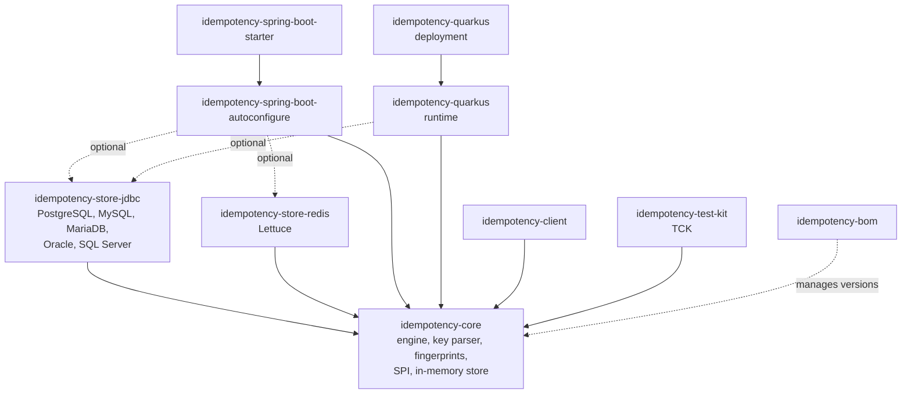
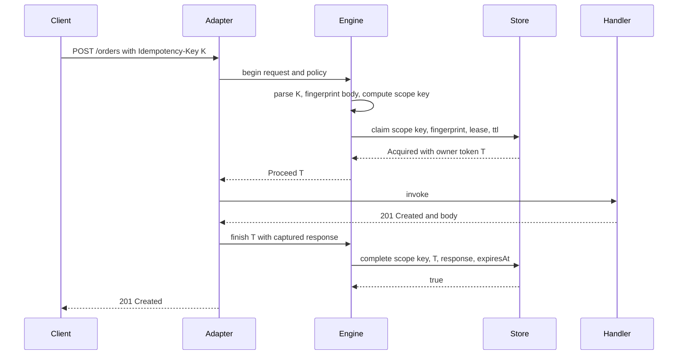
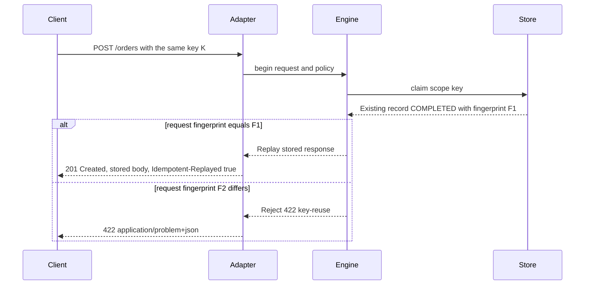
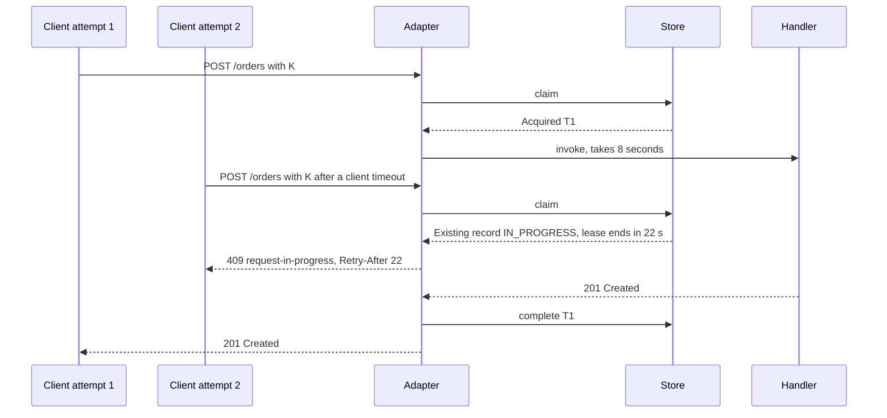
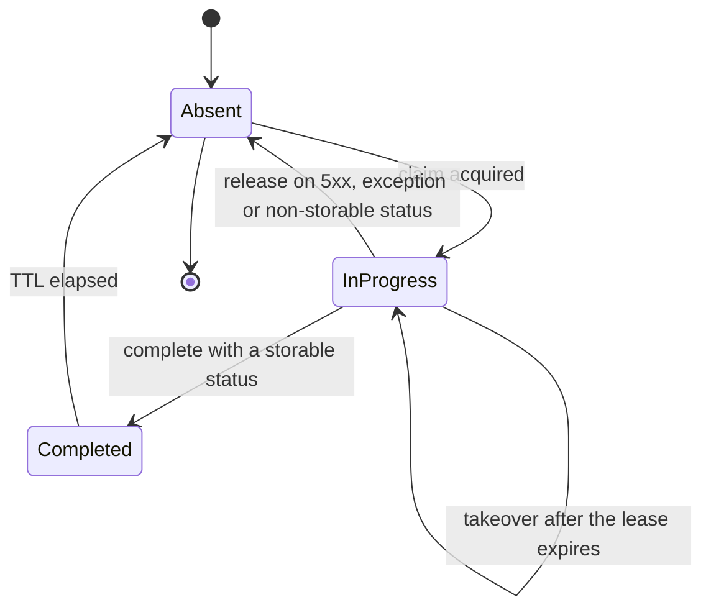

# idempotency-kit — Specification

idempotency-kit makes unsafe HTTP operations safe to retry. A client sends an `Idempotency-Key` header with a `POST` or `PATCH`; the first request runs, its response is stored, and every retry with the same key gets the stored response instead of running the operation again. The library implements the semantics of the IETF HTTPAPI draft *The Idempotency-Key HTTP Header Field* (revision 07) in a framework-free core, ships a Spring Boot starter and a Quarkus extension on top of it, and stores records in a relational database (PostgreSQL, MySQL/MariaDB, Oracle, SQL Server) or in Redis. One test compatibility kit (TCK) proves that every store and every adapter behaves the same way.

> **Status:** specification · **Last updated:** 2026-10-17

## Contents

- [How to use this document](#how-to-use-this-document)
- [1. Why this project](#1-why-this-project)
- [2. Goals and non-goals](#2-goals-and-non-goals)
- [3. Concepts and semantics](#3-concepts-and-semantics)
- [4. Functional requirements](#4-functional-requirements)
- [5. Architecture](#5-architecture)
- [6. Public API and configuration](#6-public-api-and-configuration)
- [7. Technology choices and architecture decisions](#7-technology-choices-and-architecture-decisions)
- [8. Non-functional requirements](#8-non-functional-requirements)
- [9. Testing strategy](#9-testing-strategy)
- [10. Engineering practices, CI/CD and release](#10-engineering-practices-cicd-and-release)
- [11. Documentation site](#11-documentation-site)
- [12. Repository layout](#12-repository-layout)
- [13. Roadmap](#13-roadmap)
- [14. Showcase checklist](#14-showcase-checklist)
- [15. Risks and mitigations](#15-risks-and-mitigations)
- [16. Out of scope and future ideas](#16-out-of-scope-and-future-ideas)
- [17. References](#17-references)

## How to use this document

- Each milestone in [§13](#13-roadmap) is a GitHub milestone. Its work is tracked as issues sized for one pull request and labelled with their module (`core`, `store-jdbc`, `store-redis`, `spring`, `quarkus`, `client`, `tck`, `docs`, `build`).
- One branch and one pull request per issue (`feat/m2-jdbc-claim`), squash-merged into `main`. Commit messages follow Conventional Commits with the module as scope: `feat(core): parse Structured Field keys`, `fix(store-jdbc): map SQL Server duplicate-key errors`. The release changelog is generated from them.
- Requirements carry stable IDs (`FR-06`, `NFR-03`). Tests that prove a requirement name it in `@DisplayName`, and pull requests reference it, so every requirement traces to code and tests.
- Terms are defined in [GLOSSARY.md](../GLOSSARY.md), and decisions are recorded as ADRs in [`docs/adr`](adr), indexed in [§7.2](#72-architecture-decisions). Both are the source of truth; this document links to them. Changing a decision means a new ADR that supersedes the old one, not an edit.
- This document changes through pull requests like the code does.

## 1. Why this project

Clients retry. A mobile app loses its connection after sending `POST /payments`, a gateway times out at 30 seconds while the backend finishes at 31, a message-driven integration redelivers. When the operation is not idempotent, every retry creates another order, another payment, another authorization request. The usual fixes are written per service and get the hard parts wrong: two concurrent retries both execute because the check and the insert are not atomic; a `500` is stored and replayed forever; keys are not scoped by client, so one client can read another client's response; the same key is silently accepted with a different payload.

The IETF HTTPAPI working group drafted the `Idempotency-Key` header and its error semantics; the last revision, draft-07, expired without becoming an RFC and is what this library implements. idempotency-kit implements that behaviour once, with an atomic claim protocol, leases for crashed requests, and storage that works on the databases Java teams already run.

| Skill area | Where it shows up |
|---|---|
| HTTP semantics and standards | IETF Idempotency-Key draft, RFC 9651 Structured Field parsing, RFC 9457 Problem Details, RFC 8785 JSON canonicalization, `Retry-After` |
| Concurrency and distributed correctness | Atomic claims, leases with owner tokens (fencing), lease takeover, race tests that prove exactly one execution |
| Library and API design | Framework-free core, small public surface, SPIs, sealed result types, SemVer, API compatibility checks with japicmp |
| Spring Boot internals | Auto-configuration and conditions, `@ConfigurationProperties` metadata, servlet filter ordering against Spring Security, Actuator, Micrometer Observation |
| Quarkus internals | Runtime/deployment split, build steps over the Jandex index, bytecode recording, Quarkus REST filters, Dev UI, GraalVM native image |
| Storage | Portable SQL on four vendors, conditional single-statement updates, schema delivery for Flyway and Liquibase, batched purge; Redis Lua claims and compare-and-set on the application clock |
| Testing | TCK shared by every store and adapter, jqwik property tests, Testcontainers matrix, mutation testing, JMH |
| Release engineering | Maven Central through the Central Portal, JReleaser, GPG signing, SBOM, build provenance, reproducible builds, versioned docs |
| Security | Client-scoped keys, header denylist on replay, optional AES-GCM encryption of stored bodies, no keys or bodies in logs |

## 2. Goals and non-goals

**Goals**

- G-1. Implement the server-side behaviour of the Idempotency-Key draft: key syntax, `400`/`409`/`422` semantics, published expiry policy.
- G-2. Guarantee that, while a record exists, a key runs its operation at most once, including under concurrent retries across many application instances.
- G-3. Offer the same behaviour on Spring Boot 4 (Spring MVC first, WebFlux later) and Quarkus 3, configured the idiomatic way on each.
- G-4. Store records in PostgreSQL, MySQL, MariaDB, Oracle, SQL Server, Redis/Valkey or memory, all passing one TCK.
- G-5. Give clients a helper that generates a key once and reuses it across retries.
- G-6. Release to Maven Central with documentation, an SBOM and signed artifacts, and reach a stable 1.0 API.

**Non-goals**

- Exactly-once business effects. The library prevents duplicate execution of the HTTP handler; it does not make the handler's database writes and the record completion one transaction ([ADR 0004](adr/0004-records-outside-the-business-transaction.md)).
- Idempotency for message consumers (Kafka, JMS). That is the inbox pattern and a different problem.
- Spring Boot 3, Java EE / `javax.*`, or JAX-RS runtimes other than Quarkus REST before 1.0.
- Caching `GET` responses. `@Idempotent` on safe methods is rejected.

## 3. Concepts and semantics

### 3.1 Glossary

Terms are defined in [GLOSSARY.md](../GLOSSARY.md), and this document uses them with exactly those meanings. The mechanics behind them are below: the fingerprint in [§3.4](#34-what-counts-as-the-same-request), the scope key in [ADR 0007](adr/0007-scope-key-is-a-hash.md), and claims, leases and owner tokens in [§5.7](#57-store-operations).

### 3.2 The header

- The header is `Idempotency-Key`, an Item Structured Header Field whose value is a String (RFC 9651): `Idempotency-Key: "4a1c7d9e-5f3b-4e8a-9c21-7b0d3e6f8a12"`.
- Strict mode (default) accepts only the quoted form, with characters `0x20`–`0x7E` and the escapes `\"` and `\\`. Parameters on the item (`"abc";foo=1`) are parsed and ignored.
- Lenient mode (`key.parsing=lenient`) also accepts an unquoted value made of the characters `A–Z a–z 0–9 - _ . ~ + / = :`, because many clients send bare UUIDs.
- The key length after unescaping is at most `key.max-length` (default 255). `key.format=uuid` additionally requires an RFC 9562 UUID in canonical form.
- Anything else is a malformed key and answers `400` with problem type `invalid-key`.

### 3.3 Request lifecycle

1. The adapter decides whether the request targets an idempotent operation (annotation or configured route, method in `methods`). If not, it does nothing.
2. It reads the key. No key on a required operation answers `400 missing-key`; no key on an optional operation is a bypass: the handler runs without idempotency.
3. It buffers the request body up to `request.max-body-size` and computes the fingerprint, then the scope key.
4. It claims the scope key in the store with the operation's `lease` and `ttl`.
5. **Acquired** — the handler runs. Afterwards, a response with a storable status is written with `complete`; any other status or an exception calls `release`, so a retry runs again. If `complete` or `release` fails, the handler's response is still sent (FR-40).
6. **Existing record, different fingerprint** — `422 key-reuse`, whatever the record state.
7. **Existing `IN_PROGRESS` record, same fingerprint** — `409 request-in-progress` with `Retry-After` set to the remaining lease in whole seconds (minimum 1).
8. **Existing `COMPLETED` record, same fingerprint** — the stored status, allowlisted headers and body are written back, with `Idempotent-Replayed: true`. The handler does not run.

### 3.4 What counts as the same request

The default `FingerprintStrategy` hashes, in order and length-prefixed: the method, the route template, the normalized media type (`type/subtype`, lowercase, no parameters), each header listed in `fingerprint.headers` (lowercased name, trimmed values), and the body. JSON bodies (`application/json` and `*/*+json`) are canonicalized with RFC 8785 (JCS) first, so key order and whitespace do not change the fingerprint. A JSON body that fails to parse, and every other media type, is hashed as raw bytes. Applications plug their own strategy per operation.

### 3.5 Which statuses are stored

`2xx` and `4xx` responses are stored by default: a validation error is the answer to that request and must be replayed, not re-evaluated. `5xx`, unhandled exceptions, `408`, `425` and `429` release the claim, because they describe a transient state and the client is expected to retry. Both lists are configurable through `response.store-statuses` and `response.release-statuses`.

### 3.6 Expiry policy and its publication

A `COMPLETED` record is replayed until `ttl` elapses (default 24 hours, overridable per operation). After that, the key is free and the same request runs again. The draft asks servers to publish this policy; the library publishes it in three places: a startup log line per idempotent operation, the Spring Actuator `idempotency` endpoint and Quarkus Dev UI page, and the OpenAPI description of each operation (M5).

### 3.7 Guarantees and limits

- While a record exists, the handler runs at most once per scope key, across threads and instances that share a store.
- A request that runs longer than `lease` can be taken over by a retry; both executions then complete, and the second `complete` wins only if it still holds the lease. The first one's `complete` returns `false`, is logged at `WARN` and counted as `lease_lost`. `lease` must therefore exceed the longest expected handler time of its operation, which is why it can be set per operation; startup fails if any operation has `lease >= ttl`.
- A crash between the handler's commit and `complete` leaves an `IN_PROGRESS` record; after the lease expires, a retry runs again. Handlers that cannot tolerate this keep their own natural idempotency (unique business keys).
- Timestamps come from the application's `Clock`, not the database or Redis ([ADR 0006](adr/0006-time-from-the-application-clock.md)). Instance clocks must be synchronised (NTP); the lease must be larger than the worst clock skew.
- If the store fails after the handler ran, the handler's response is still sent, because its effects already happened. The record stays `IN_PROGRESS` until its lease ends, so a retry gets `409` until then and runs again afterwards (FR-40).

### 3.8 Scoping and anonymous clients

Under client scope, a request without a client identity belongs to the anonymous client, so every unauthenticated caller shares one namespace: whoever learns a key can replay its response, or see `422` for a different payload. On such operations the key is the only secret. Public operations should use `key.format=uuid` so that keys carry 122 random bits, and operations whose keys are shared by design should declare `scope = GLOBAL`.

## 4. Functional requirements

### 4.1 Key handling

- **FR-01 Key syntax.** Strict mode accepts exactly the RFC 9651 String form; lenient mode also accepts the unquoted character set in [§3.2](#32-the-header). Malformed keys answer `400 invalid-key` and never reach the store.
- **FR-02 Key limits.** Keys longer than `key.max-length` or, with `key.format=uuid`, not a canonical UUID answer `400 invalid-key`.
- **FR-03 Missing key.**
  - *Given* an operation with `required = true`, *when* a request arrives without the header, *then* the response is `400 missing-key` and the handler is not invoked.
  - *Given* an operation with `required = false`, *when* a request arrives without the header, *then* the handler runs and no record is created.

### 4.2 Execution and replay

- **FR-04 First execution.** A request with a new key claims it, runs the handler once, and stores the response when its status is storable.
- **FR-05 Replay.**
  - *Given* a `COMPLETED` record for key K with fingerprint F, *when* a request with K and fingerprint F arrives before the TTL elapses, *then* the response has the stored status, the stored body byte for byte, the allowlisted headers and `Idempotent-Replayed: true`, and the handler execution count stays the same.
- **FR-06 Key reuse.**
  - *Given* any record for key K with fingerprint F, *when* a request with K and a fingerprint other than F arrives, *then* the response is `422 key-reuse` and the record is unchanged.
- **FR-07 Request in progress.**
  - *Given* an `IN_PROGRESS` record for K whose lease ends in 12.3 seconds, *when* a retry with the same fingerprint arrives, *then* the response is `409 request-in-progress` with `Retry-After: 13`, and the first request still completes normally.
- **FR-08 Transient responses release the key.**
  - *Given* a handler that returns `503` or throws, *when* the request completes, *then* no record remains and a retry with the same key runs the handler again.
- **FR-09 Lease expiry.**
  - *Given* an `IN_PROGRESS` record whose lease has expired, *when* a retry arrives with any fingerprint, *then* it acquires a new claim with a new owner token and the handler runs; a late `complete` from the old owner returns `false` and changes nothing.
- **FR-10 TTL expiry.** After `ttl`, a request with the same key runs as new, with any fingerprint.
- **FR-11 Concurrency.**
  - *Given* 64 concurrent requests with the same key and body against two application instances sharing one store, *when* they all finish, *then* the handler ran exactly once and every response is either the original response (status and body) or `409 request-in-progress`.

### 4.3 Scoping and fingerprinting

- **FR-12 Client scope.** The same key sent by two different client identities produces two independent records; neither can replay the other's response. `@Idempotent(scope = GLOBAL)` drops the client from the scope key for server-to-server keys. Requests without an identity share the anonymous client ([§3.8](#38-scoping-and-anonymous-clients)).
- **FR-13 Route scope.** The same key on two different route templates or methods produces two independent records.
- **FR-14 Fingerprint stability.** JSON bodies that differ only in key order, insignificant whitespace or number representation that JCS normalizes produce the same fingerprint; any change in a value, the route, the media type or a selected header changes it.
- **FR-15 Pluggable fingerprint.** `@Idempotent(fingerprint = MyStrategy.class)` uses the given strategy, instantiated through the framework's container when it is a bean, otherwise through its no-argument constructor.

### 4.4 Applicability and limits

- **FR-16 Methods.** By default only `POST` and `PATCH` are key-aware; `methods` extends this to `PUT` and `DELETE`. `@Idempotent` on a `GET`, `HEAD`, `OPTIONS` or `TRACE` handler fails application startup (Spring) or the build (Quarkus) with a message naming the handler.
- **FR-17 Configured routes.** Routes listed under `routes` (method, path pattern, TTL, lease, required) are idempotent without annotations, for code the application does not own.
- **FR-18 Request size.** A body larger than `request.max-body-size` on an idempotent operation answers `413 request-too-large` before the handler runs.
- **FR-19 Response size.** A storable response larger than `response.max-body-size` is stored without its body (`body_omitted = true`) under the default `response.oversized=store-without-body`, and its replays carry the status and allowlisted headers with an empty body; `response.oversized=release` releases the claim instead. Either case logs one `WARN` per route.
- **FR-20 Unsupported handlers.** Streaming and asynchronous handlers (`SseEmitter`, `StreamingResponseBody`, `DeferredResult`, `Callable`, `Flux`, `Multi`) marked idempotent fail startup or the build. Reactive return types (`Mono`, `Uni`, `CompletionStage`) are rejected until M7.
- **FR-21 Store failure.** When the store throws or times out (`store.timeout`, default 2 s), `store.on-failure=fail-closed` (default) answers `503 store-unavailable` with `Retry-After: 1` and does not run the handler; `fail-open` runs the handler as a bypass, reported with outcome `fail_open`.
- **FR-40 Store failure after the handler.**
  - *Given* a handler that returned `201`, *when* `complete` throws or exceeds `store.timeout`, *then* the client receives the `201` and its body, a `WARN` is logged, `idempotency.store.calls` records `result=error`, and a retry before the lease ends gets `409 request-in-progress`. A failed `release` is handled the same way.

### 4.5 Errors

- **FR-22 Problem Details.** Every response the library generates is `application/problem+json` (RFC 9457) with `type`, `title`, `status`, `detail` and `instance`, plus the extension member `idempotencyKey` (the received key, when parseable). Type URIs are stable, documented under `problems.base-uri`, and resolve to pages on the documentation site.

### 4.6 Stores

- **FR-23 In-memory store.** A bounded (`store.in-memory.max-entries`, default 10 000) thread-safe store for tests and single-instance development; it logs a `WARN` at startup that it is not shared between instances.
- **FR-24 JDBC store.** Implements the SPI on PostgreSQL, MySQL, MariaDB, Oracle and SQL Server with the dialect detected from `DatabaseMetaData` or set explicitly. It uses its own auto-commit connections from the configured `DataSource`.
- **FR-25 Schema delivery.** The JDBC module ships vendor DDL (`db/idempotency/schema-{vendor}.sql`), a Liquibase changelog (`db/idempotency/changelog.yaml`) to include from the application's master changelog, and Flyway-compatible copies of the DDL. With `store.jdbc.validate-schema=true` (default) startup fails with the script path when the table or a column is missing.
- **FR-26 Purge.** A scheduled job deletes expired records in batches of `store.jdbc.cleanup.batch-size` every `store.jdbc.cleanup.interval`; concurrent purges on several instances are safe.
- **FR-27 Redis store.** Implements the SPI with Lua scripts for `claim`, `complete` and `release` that decide expiry from the application clock ([ADR 0006](adr/0006-time-from-the-application-clock.md)); key expiry only bounds memory, so it needs no purge job, and it works on Redis Cluster because every script touches one key.

### 4.7 Adapters

- **FR-28 Spring Boot starter.** Adding the starter enables the Spring MVC adapter with no code beyond `@Idempotent`; the store is auto-configured ([§5.5](#55-spring-boot-adapter)). Every property has configuration metadata with a description and default.
- **FR-29 Quarkus extension.** Adding the extension discovers `@Idempotent` at build time, validates handlers, and registers the Quarkus REST filters; it works in JVM and native mode.
- **FR-30 Client identity.** Spring resolves the identity from the `SecurityContext` or `HttpServletRequest#getUserPrincipal`, Quarkus from `SecurityIdentity`; `client-identity.source=header` reads `client-identity.header` instead. An application bean of type `ClientIdentityResolver` overrides both.

### 4.8 Client helpers

- **FR-31 Key reuse across retries.** `IdempotentCall` generates one key (UUIDv4, or UUIDv7 when configured) per logical call and sends it on every attempt; it retries on I/O errors, `409` (honouring `Retry-After`), `503` and other `5xx`, never on `400` or `422`, with exponential backoff and jitter up to `maxAttempts`.
- **FR-32 Interceptors.** A Spring `RestClient` interceptor and a MicroProfile REST Client `ClientRequestFilter` add a fresh key to `POST`/`PATCH` requests that do not already carry one.

### 4.9 Observability, documentation, security

- **FR-33 Metrics.** Each outcome increments `idempotency.requests` with tags `outcome`, `method`, `route`; every store call records `idempotency.store.calls` (timer) with `operation`, `store`, `result` ([§6.8](#68-metrics-and-observations)).
- **FR-34 Tracing.** The current span gets `idempotency.outcome` and `idempotency.replayed` attributes, through Micrometer Observation on Spring and OpenTelemetry on Quarkus.
- **FR-35 Health.** A health contributor reports the store as `UP` or `DOWN` from a cheap ping (`SELECT 1` / `PING`).
- **FR-36 OpenAPI.** When springdoc-openapi or SmallRye OpenAPI is present, each idempotent operation documents the `Idempotency-Key` header (required or optional), the `400`, `409`, `422` responses and its TTL.
- **FR-37 Header denylist.** `Set-Cookie`, `Authorization`, `Proxy-Authenticate`, `WWW-Authenticate` and hop-by-hop headers are never stored or replayed; configuring them in `response.replay-headers` fails startup.
- **FR-38 Body encryption.** With `encryption.enabled=true`, stored bodies are encrypted with AES-256-GCM under the active key id; records written under older key ids remain readable while their key is configured.
- **FR-39 Inspection.** The Spring Actuator endpoint `idempotency` and the Quarkus Dev UI page list idempotent operations with their policy; the Dev UI page (dev mode only) also lists the 50 most recent records without bodies.

## 5. Architecture

### 5.1 Modules



`idempotency-core` has no runtime dependencies ([ADR 0003](adr/0003-zero-runtime-dependencies-in-core.md)). Framework modules depend on the core, never the other way round. The Quarkus extension implements its Redis store on the Quarkus Redis client instead of depending on `idempotency-store-redis` ([ADR 0011](adr/0011-quarkus-uses-its-own-redis-client.md)).

### 5.2 Engine pipeline

`IdempotencyEngine` is the only place where the protocol lives. Adapters translate their request and response types into `IncomingRequest` and `CapturedResponse` and act on the returned `Decision`:

1. `begin(IncomingRequest, IdempotencyPolicy)` parses the key, checks limits, computes fingerprint and scope key, and calls `store.claim(...)`.
2. It returns one of `Decision.Bypass` (reason `NO_KEY` for an optional operation without a key, or `FAIL_OPEN` when the store failed under fail-open), `Decision.Proceed` (claim acquired), `Decision.Replay` (stored response) or `Decision.Reject` (problem plus headers such as `Retry-After`).
3. After the handler, the adapter calls `finish(proceed, capturedResponse)`, which applies the status policy and calls `complete` or `release`; on an exception it calls `abort(proceed, cause)`, which releases.
4. Every step reports to `IdempotencyObserver`.

### 5.3 Request flows

First call:



Retry of a finished request, with the same payload or a changed one:



Retry while the first request is still running:



### 5.4 Record states



An expired lease and an expired TTL are both equivalent to `Absent` in every store ([ADR 0008](adr/0008-expired-record-is-absent.md)); the physical row may linger until the purge job runs.

### 5.5 Spring Boot adapter

- `IdempotencyFilter` extends `OncePerRequestFilter` and runs at `web.filter-order`, by default just after the Spring Security filter chain so that the principal is available.
- For requests whose method is in `methods`, it resolves the handler through `RequestMappingHandlerMapping#getHandler`, reads `@Idempotent` from the method or its class, and takes the route template from `HandlerMapping.BEST_MATCHING_PATTERN_ATTRIBUTE`. `IdempotentHandlerResolver` caches the annotation lookup per `HandlerMethod`.
- It wraps the request in `CachedBodyRequest` (reads up to the limit, then serves the bytes again) and the response in `ContentCachingResponseWrapper`, calls the chain, captures status, headers and body, calls `finish`, then copies the body to the real response.
- `Reject` and `Replay` decisions are written directly by the filter; the chain is not called.
- `IdempotentHandlerValidator` runs on `ContextRefreshedEvent` and fails startup for FR-16 and FR-20 violations.
- Auto-configuration classes: `IdempotencyAutoConfiguration` (engine, policy defaults, observer), `IdempotencyJdbcStoreAutoConfiguration`, `IdempotencyRedisStoreAutoConfiguration`, `IdempotencyInMemoryStoreAutoConfiguration`, `IdempotencyWebMvcAutoConfiguration` (`@ConditionalOnWebApplication(type = SERVLET)`), `IdempotencyObservabilityAutoConfiguration` (`@ConditionalOnClass(MeterRegistry.class)`), `IdempotencyActuatorAutoConfiguration`, `IdempotencyOpenApiAutoConfiguration`. All are registered in `META-INF/spring/org.springframework.boot.autoconfigure.AutoConfiguration.imports`.
- Store selection with `store.type=auto`: an application `IdempotencyStore` bean wins; otherwise JDBC when a `DataSource` bean exists and the JDBC module is on the classpath; otherwise Redis when the Redis module is on the classpath and a Redis URL is available (Spring Boot's Redis connection details or `store.redis.url`); otherwise in-memory.

### 5.6 Quarkus extension

- **Deployment module.** `IdempotencyProcessor` build steps: register the feature `idempotency`; scan the combined Jandex index for `@Idempotent` and produce `IdempotentOperationBuildItem`s with method, route template (application path, class `@Path` and method `@Path` joined) and policy; validate handlers (FR-16, FR-20) and fail the build with the offending method; select the store from `quarkus.idempotency.store.type` and the available capabilities (Agroal data source, Quarkus Redis client); register reflection for the problem payload; contribute the health check and the Dev UI card.
- **Runtime module.** `IdempotencyRecorder` turns the build items into an operation registry at static init. `IdempotencyServerFilters` holds a `@ServerRequestFilter` (key, body, claim, reject/replay) and a `@ServerResponseFilter` (complete for responses without an entity). `IdempotencyWriterInterceptor` tees the serialized entity into a bounded buffer and completes after `proceed()`.
- **Threading.** Store calls are blocking. The filters use the default `nonBlocking = false`, so they run on the endpoint's execution thread (worker or virtual thread), never on the event loop. An integration test asserts `!io.vertx.core.Context.isOnEventLoopThread()` inside the store.

### 5.7 Store operations

**JDBC** (all statements single-row, auto-commit, `READ COMMITTED` is sufficient):

| Operation | Statements |
|---|---|
| `claim` | 1. Insert the `IN_PROGRESS` row: `INSERT … ON CONFLICT (scope_key) DO NOTHING` on PostgreSQL; plain `INSERT` elsewhere, treating SQLState class `23` (MySQL 1062, Oracle ORA-00001, SQL Server 2601/2627) as "exists". One row inserted means `Acquired`. 2. Take over a dead row: `UPDATE … SET state='IN_PROGRESS', owner_token=?, fingerprint=?, lease_until=?, expires_at=?, response_*=NULL WHERE scope_key=? AND ((state='IN_PROGRESS' AND lease_until < ?) OR expires_at < ?)`. One row updated means `Acquired`. 3. `SELECT` the row and return `Existing`. If the row disappeared (purged in between), start again; after three rounds throw `IdempotencyStoreException`. |
| `complete` | `UPDATE … SET state='COMPLETED', owner_token=NULL, lease_until=NULL, response_status=?, response_headers=?, response_body=?, body_omitted=?, completed_at=?, expires_at=? WHERE scope_key=? AND owner_token=? AND state='IN_PROGRESS'`; zero rows means the lease was lost. |
| `release` | `DELETE … WHERE scope_key=? AND owner_token=? AND state='IN_PROGRESS'` |
| `purgeExpired` | Dialect-specific bounded delete of rows with `expires_at < ?` (for example a `scope_key IN (SELECT … FETCH FIRST ? ROWS ONLY)` subquery), repeated until a batch deletes fewer rows than the batch size. |

**Redis** (key `{prefix}{scopeKey}`). The value starts with a fixed-width header: one state byte `P`/`C`, the 36-character owner token (blank once completed), and the lease end and expiry as 13-digit epoch milliseconds; the encoded record follows. Every operation is a Lua script that receives the application's `now` and decides expiry from the header, never from the Redis clock ([ADR 0006](adr/0006-time-from-the-application-clock.md)). The key's `PX` expiry only bounds memory: the lease end or expiry plus a fixed margin.

| Operation | Script |
|---|---|
| `claim` | If the key is missing, holds `P` with a lease end before `now`, or has an expiry before `now`: `SET` the new in-progress value with `PX` and return `Acquired`. Otherwise return the stored value as `Existing`. |
| `complete` | If the value starts with `P` and the caller's token, `SET` the completed value with `PX` and return 1; else return 0. |
| `release` | If the value starts with `P` and the caller's token, `DEL` the key. |
| `purgeExpired` | No-op; key expiry bounds memory. |

```lua
-- complete.lua: KEYS[1] record key, ARGV[1] owner token, ARGV[2] completed value, ARGV[3] PX in ms
local v = redis.call('GET', KEYS[1])
if v and string.sub(v, 1, 1) == 'P' and string.sub(v, 2, 37) == ARGV[1] then
  redis.call('SET', KEYS[1], ARGV[2], 'PX', ARGV[3])
  return 1
end
return 0
```

## 6. Public API and configuration

Package root: `io.github.eduardoalecrim.idempotency`. Packages named `internal` are not API and are excluded from compatibility checks.

### 6.1 Annotation

```java
package io.github.eduardoalecrim.idempotency;

@Target({ElementType.METHOD, ElementType.TYPE})
@Retention(RetentionPolicy.RUNTIME)
@Documented
public @interface Idempotent {
    /** Whether a request without the header is rejected with 400. */
    boolean required() default true;
    /** "24h", "30m", "90s", "7d" or ISO-8601 ("PT24H"); empty means the global default. */
    String ttl() default "";
    /** Lease of in-progress records, in the same formats; empty means the global default. */
    String lease() default "";
    /** CLIENT scopes keys by client identity; GLOBAL shares them across clients. */
    Scope scope() default Scope.CLIENT;
    /** Strategy used to fingerprint the request. */
    Class<? extends FingerprintStrategy> fingerprint() default FingerprintStrategy.Default.class;
    /** Request headers added to the fingerprint, on top of the global list. */
    String[] fingerprintHeaders() default {};

    enum Scope { CLIENT, GLOBAL }
}
```

On a type, the annotation applies to every handler whose method is in `methods`; a method-level annotation overrides it.

### 6.2 Engine and SPI

```java
public final class IdempotencyEngine {
    public static Builder builder();   // store, clock, observer, problem factory, body codec
    public Decision begin(IncomingRequest request, IdempotencyPolicy policy);
    public void finish(Decision.Proceed proceed, CapturedResponse response);
    public void abort(Decision.Proceed proceed, Throwable cause);
}

public sealed interface Decision {
    record Bypass(BypassReason reason) implements Decision {}
    record Proceed(ScopeKey key, OwnerToken token, IdempotencyPolicy policy) implements Decision {}
    record Replay(StoredResponse response) implements Decision {}
    record Reject(Problem problem, Map<String, String> headers) implements Decision {}
}

public enum BypassReason { NO_KEY, FAIL_OPEN }

public record IdempotencyPolicy(boolean required, Duration ttl, Duration lease, Scope scope,
                                FingerprintStrategy fingerprint, List<String> fingerprintHeaders,
                                StatusPolicy statusPolicy, Set<String> replayHeaders,
                                long maxRequestBytes, long maxResponseBytes, OversizedPolicy oversized) {}
```

```java
package io.github.eduardoalecrim.idempotency.spi;

public interface IdempotencyStore {
    ClaimResult claim(ClaimRequest request);
    boolean complete(ScopeKey key, OwnerToken token, StoredResponse response, Instant completedAt, Instant expiresAt);
    void release(ScopeKey key, OwnerToken token);
    Optional<IdempotencyRecord> find(ScopeKey key, Instant now);
    int purgeExpired(Instant now, int batchSize);
    StoreHealth health();
}

public record ClaimRequest(ScopeKey key, ScopeParts parts, Fingerprint fingerprint,
                           Instant now, Instant leaseUntil, Instant expiresAt) {}

public sealed interface ClaimResult {
    record Acquired(OwnerToken token) implements ClaimResult {}
    record Existing(IdempotencyRecord record) implements ClaimResult {}
}

public interface IdempotencyStoreInspector {          // optional, for Dev UI and diagnostics
    List<RecordSummary> recent(int limit);
}

public interface FingerprintStrategy {
    Fingerprint fingerprint(FingerprintInput input);
    final class Default implements FingerprintStrategy { /* §3.4 */ }
}

public interface ClientIdentityResolver<R> { Optional<String> resolve(R request); }

public interface BodyCodec {                           // identity by default, AesGcmBodyCodec for FR-38
    byte[] encode(byte[] body);
    byte[] decode(byte[] stored);
}

public interface IdempotencyObserver {
    default void onOutcome(Outcome outcome, RouteRef route, Duration elapsed) {}
    default void onStoreCall(StoreOperation operation, Duration elapsed, boolean success) {}
    default void onLeaseLost(RouteRef route) {}
}

public enum Outcome { EXECUTED, REPLAYED, IN_PROGRESS, KEY_REUSE, MISSING_KEY, INVALID_KEY,
                      REQUEST_TOO_LARGE, RELEASED, STORE_UNAVAILABLE, NO_KEY, FAIL_OPEN }
```

Value types (`ScopeKey`, `OwnerToken`, `Fingerprint`, `StoredResponse`, `IdempotencyRecord`) are records with validating constructors. Stores receive only computed values; they never parse keys or bodies.

### 6.3 Spring Boot configuration (`idempotency.*`)

| Property | Default | Description |
|---|---|---|
| `idempotency.enabled` | `true` | Turns the adapter off without removing the dependency. |
| `idempotency.header-name` | `Idempotency-Key` | Request header carrying the key. |
| `idempotency.methods` | `POST,PATCH` | Methods that can be idempotent; `PUT` and `DELETE` allowed. |
| `idempotency.key.parsing` | `strict` | `strict` or `lenient` ([§3.2](#32-the-header)). |
| `idempotency.key.max-length` | `255` | Maximum key length after unescaping. |
| `idempotency.key.format` | `any` | `any` or `uuid`. |
| `idempotency.default-ttl` | `24h` | TTL of completed records. |
| `idempotency.lease` | `30s` | Default lease of in-progress records, overridable per operation; must be shorter than the operation's TTL. |
| `idempotency.client-identity.source` | `principal` | `principal`, `header` or `none`. |
| `idempotency.client-identity.header` | — | Header used when the source is `header`. |
| `idempotency.fingerprint.headers` | `[]` | Headers added to every fingerprint. |
| `idempotency.fingerprint.canonicalize-json` | `true` | Apply RFC 8785 to JSON bodies. |
| `idempotency.request.max-body-size` | `1MB` | Larger bodies answer `413`. |
| `idempotency.response.max-body-size` | `1MB` | Larger bodies follow `response.oversized`. |
| `idempotency.response.oversized` | `store-without-body` | `store-without-body` or `release`. |
| `idempotency.response.store-statuses` | `2xx,4xx` | Status classes or codes that are stored. |
| `idempotency.response.release-statuses` | `408,425,429` | Codes released even when their class is stored. |
| `idempotency.response.replay-headers` | `Content-Type,Content-Language,Location,ETag,Last-Modified,Cache-Control` | Headers restored on replay. |
| `idempotency.problems.base-uri` | `https://eduardo-alecrim.github.io/idempotency-kit/problems/` | Base of problem `type` URIs. |
| `idempotency.web.filter-order` | Spring Security order + 10 | Position of `IdempotencyFilter`. |
| `idempotency.store.type` | `auto` | `auto`, `jdbc`, `redis` or `in-memory`. |
| `idempotency.store.timeout` | `2s` | Timeout of a single store call. |
| `idempotency.store.on-failure` | `fail-closed` | `fail-closed` or `fail-open`. |
| `idempotency.store.jdbc.table-name` | `idempotency_record` | Validated against `[A-Za-z_][A-Za-z0-9_.]*`. |
| `idempotency.store.jdbc.dialect` | `auto` | `auto`, `postgresql`, `mysql`, `mariadb`, `oracle`, `sqlserver`. |
| `idempotency.store.jdbc.validate-schema` | `true` | Fail startup when the table does not match. |
| `idempotency.store.jdbc.initialize-schema` | `never` | `never`, `embedded` or `always`; runs `schema-{vendor}.sql`. |
| `idempotency.store.jdbc.cleanup.enabled` / `.interval` / `.batch-size` | `true` / `5m` / `1000` | Purge job switch, interval and rows per delete statement. |
| `idempotency.store.redis.url` | — | Used when Spring Boot's Redis connection details are absent. |
| `idempotency.store.redis.key-prefix` | `idem:` | Prefix of every key. |
| `idempotency.store.in-memory.max-entries` | `10000` | Upper bound of the in-memory store. |
| `idempotency.encryption.enabled` / `.active-key-id` / `.keys.<id>` | `false` / — / — | Encrypt stored bodies (FR-38) with Base64 AES-256 keys by id; new records use the active id. |
| `idempotency.routes[n].methods` / `.path` / `.ttl` / `.lease` / `.required` | — | Idempotent operations declared without annotations (FR-17). |

`IdempotencyProperties` is validated with `@Validated`; invalid combinations (`lease >= ttl`, denied replay headers, unknown dialect) fail startup with a `FailureAnalyzer` message.

### 6.4 Quarkus configuration (`quarkus.idempotency.*`)

The Quarkus extension exposes the same keys under `quarkus.idempotency.` through an `@ConfigMapping` interface, with these differences:

| Property | Phase | Notes |
|---|---|---|
| `quarkus.idempotency.enabled` | build time | Disabling removes the filters from the application. |
| `quarkus.idempotency.store.type` | build time | `auto`, `jdbc`, `redis`, `in-memory`; `auto` follows the capabilities present. |
| `quarkus.idempotency.store.jdbc.datasource` | build time | Named data source; default data source when absent. |
| `quarkus.idempotency.store.redis.client-name` | build time | Named Redis client; default client when absent. |
| `quarkus.idempotency.store.jdbc.cleanup.every` | runtime | Scheduler expression for the purge job (`quarkus-scheduler`). |
| `quarkus.idempotency.web.filter-priority` | build time | JAX-RS priority of the request filter. |
| every other key from §6.3 | runtime | Same name and default. |

### 6.5 HTTP behaviour

| Situation | Status | Body | Handler runs | Record afterwards |
|---|---|---|---|---|
| Not an idempotent operation | handler's | handler's | yes | none |
| Optional operation, no key | handler's | handler's | yes | none |
| Required operation, no key | `400` | `missing-key` | no | none |
| Malformed or too long key | `400` | `invalid-key` | no | none |
| Body over `request.max-body-size` | `413` | `request-too-large` | no | none |
| New key, storable status | handler's | handler's | yes | `COMPLETED` |
| New key, `5xx`, exception or released status | handler's | handler's | yes | none |
| Same key, same fingerprint, completed | stored | stored, plus `Idempotent-Replayed: true` | no | unchanged |
| Same key, different fingerprint | `422` | `key-reuse` | no | unchanged |
| Same key, same fingerprint, in progress | `409` + `Retry-After` | `request-in-progress` | no | unchanged |
| Same key after the lease expired | handler's | handler's | yes | new claim |
| Same key after the TTL | handler's | handler's | yes | new record |
| Store unavailable, `fail-closed` | `503` + `Retry-After: 1` | `store-unavailable` | no | — |
| Store unavailable, `fail-open` | handler's | handler's | yes | none |
| Store fails after the handler ran | handler's | handler's | yes | `IN_PROGRESS` until the lease ends |

### 6.6 Problem types

| Type (relative to `problems.base-uri`) | Status | Title |
|---|---|---|
| `missing-key` | 400 | Idempotency key required |
| `invalid-key` | 400 | Invalid idempotency key |
| `request-too-large` | 413 | Request too large for idempotent processing |
| `request-in-progress` | 409 | Request with this idempotency key is in progress |
| `key-reuse` | 422 | Idempotency key reused with a different request |
| `store-unavailable` | 503 | Idempotency store unavailable |

```json
{
  "type": "https://eduardo-alecrim.github.io/idempotency-kit/problems/key-reuse",
  "title": "Idempotency key reused with a different request",
  "status": 422,
  "detail": "This key was first used with a different request body. Send a new key for a new request.",
  "instance": "/orders",
  "idempotencyKey": "4a1c7d9e-5f3b-4e8a-9c21-7b0d3e6f8a12"
}
```

A `409` also carries `Retry-After` with the remaining lease in seconds, and a `503` carries `Retry-After: 1`. Problem details never contain fingerprints, bodies or the client identity.

### 6.7 Storage schemas

PostgreSQL (`schema-postgresql.sql`):

```sql
CREATE TABLE idempotency_record (
    scope_key        CHAR(64)                 NOT NULL,
    idempotency_key  VARCHAR(255)             NOT NULL,
    client_id        VARCHAR(255)             NOT NULL,
    http_method      VARCHAR(10)              NOT NULL,
    route            VARCHAR(512)             NOT NULL,
    fingerprint      CHAR(64)                 NOT NULL,
    state            VARCHAR(16)              NOT NULL,
    owner_token      CHAR(36),
    lease_until      TIMESTAMP WITH TIME ZONE,
    response_status  SMALLINT,
    response_headers TEXT,
    response_body    BYTEA,
    body_omitted     BOOLEAN                  NOT NULL DEFAULT FALSE,
    codec_key_id     VARCHAR(64),
    created_at       TIMESTAMP WITH TIME ZONE NOT NULL,
    completed_at     TIMESTAMP WITH TIME ZONE,
    expires_at       TIMESTAMP WITH TIME ZONE NOT NULL,
    CONSTRAINT pk_idempotency_record PRIMARY KEY (scope_key),
    CONSTRAINT ck_idempotency_record_state CHECK (state IN ('IN_PROGRESS', 'COMPLETED'))
);

CREATE INDEX ix_idempotency_record_expires_at ON idempotency_record (expires_at);
```

Type mapping for the other vendors:

| Column | MySQL / MariaDB | Oracle | SQL Server |
|---|---|---|---|
| text columns | `VARCHAR(n)` | `VARCHAR2(n CHAR)` | `NVARCHAR(n)` |
| `response_status` | `SMALLINT` | `NUMBER(3)` | `SMALLINT` |
| `response_headers` | `TEXT` | `CLOB` | `NVARCHAR(MAX)` |
| `response_body` | `LONGBLOB` | `BLOB` | `VARBINARY(MAX)` |
| `body_omitted` | `BOOLEAN` | `NUMBER(1)` (19c compatible) | `BIT` |
| timestamps | `DATETIME(6)`, always UTC | `TIMESTAMP WITH TIME ZONE` | `DATETIMEOFFSET(6)` |

`response_headers` holds header lines in HTTP/1.1 field syntax (`Name: value`, CRLF-separated); header values cannot contain CR or LF, so the format needs no escaping ([ADR 0016](adr/0016-stored-headers-use-http-field-lines.md)). Redis values use the same fields in a versioned binary encoding (`RecordCodec`) after the fixed-width header described in [§5.7](#57-store-operations); the first byte after the header is the format version.

### 6.8 Metrics and observations

| Name | Type | Tags |
|---|---|---|
| `idempotency.requests` | counter | `outcome` (lowercase `Outcome`), `method`, `route` |
| `idempotency.store.calls` | timer | `operation` (`claim`, `complete`, `release`, `find`, `purge`), `store`, `result` (`success`, `error`, `lease_lost`) |
| `idempotency.records.purged` | counter | `store` |
| `idempotency.response.oversized` | counter | `route` |
| observation `idempotency.request` | Micrometer Observation | low cardinality: `outcome`, `store`; high cardinality: `idempotency.scope_key` |

Keys and bodies are never logged at `INFO` or above; `DEBUG` logs print the scope key hash, not the raw key.

## 7. Technology choices and architecture decisions

### 7.1 Technology

| Concern | Choice | Why |
|---|---|---|
| Language | Java 17 baseline (`--release 17`), CI on 17, 21, 25 | Minimum of Spring Boot 4 and Quarkus 3; covers every LTS in use. |
| Build | Maven 3.10 with wrapper, multi-module, BOM | First-class Quarkus extension tooling; what library consumers expect. |
| Spring | Spring Boot 4.1.x, Spring Framework 7, Spring MVC (WebFlux in M7) | Current generation; Jakarta EE 11 APIs. |
| Quarkus | Quarkus 3.40 LTS, Quarkus REST | LTS gives a support window that matches a library's; 4.x waits for its first LTS ([ADR 0018](adr/0018-quarkus-3-lts-until-a-4x-lts.md)). |
| Redis client | Lettuce (plain and Spring), Quarkus Redis client (Quarkus) | Native fit on each side ([ADR 0011](adr/0011-quarkus-uses-its-own-redis-client.md)). |
| Null safety | JSpecify annotations, NullAway through Error Prone | Same annotations Spring Framework 7 uses; nulls caught at compile time. |
| Formatting | Spotless with palantir-java-format, SPDX license headers | Deterministic formatting, no review comments about style. |
| Tests | JUnit 6, AssertJ, jqwik, Testcontainers, Awaitility, PIT, JMH | See [§9](#9-testing-strategy). |
| Release | JReleaser, Central Portal, GPG, CycloneDX | See [§10](#10-engineering-practices-cicd-and-release). |
| Docs | MkDocs Material, `mike` for versions | Fast to write, versioned per release. |

### 7.2 Architecture decisions

Decisions are recorded as ADRs in [`docs/adr`](adr). The ADR is the source of truth; a changed decision gets a new ADR that supersedes the old one.

| ADR | Decision |
|---|---|
| [0001](adr/0001-record-architecture-decisions.md) | Record architecture decisions |
| [0002](adr/0002-framework-free-core.md) | Framework-free core with thin adapters |
| [0003](adr/0003-zero-runtime-dependencies-in-core.md) | Zero runtime dependencies in core |
| [0004](adr/0004-records-outside-the-business-transaction.md) | Records live outside the business transaction |
| [0005](adr/0005-leases-with-owner-tokens.md) | Leases with owner tokens instead of distributed locks |
| [0006](adr/0006-time-from-the-application-clock.md) | Time comes from the application clock, in every store |
| [0007](adr/0007-scope-key-is-a-hash.md) | The scope key is a hash |
| [0008](adr/0008-expired-record-is-absent.md) | An expired record is an absent record |
| [0009](adr/0009-transient-responses-are-never-stored.md) | Transient responses are never stored |
| [0010](adr/0010-spring-adapter-is-a-servlet-filter.md) | The Spring adapter is a servlet filter |
| [0011](adr/0011-quarkus-uses-its-own-redis-client.md) | Quarkus uses its own Redis client |
| [0012](adr/0012-blocking-store-spi.md) | Blocking store SPI |
| [0013](adr/0013-no-java-21-apis-in-main-code.md) | No Java 21 APIs in main code |
| [0014](adr/0014-release-with-jreleaser.md) | Release with JReleaser through the Central Portal |
| [0015](adr/0015-problem-types-resolve-to-documentation.md) | Problem types resolve to documentation |
| [0016](adr/0016-stored-headers-use-http-field-lines.md) | Stored headers use HTTP field lines |
| [0017](adr/0017-schema-delivery-without-flyway-registration.md) | Schema delivery without automatic Flyway registration |
| [0018](adr/0018-quarkus-3-lts-until-a-4x-lts.md) | The Quarkus extension targets the 3.x LTS until a 4.x LTS exists |

## 8. Non-functional requirements

| ID | Requirement | Target and how it is measured |
|---|---|---|
| NFR-01 | Adapter overhead, in-memory store | Added p99 latency below 1 ms for a 1 KiB JSON `POST` at 1 000 req/s, Spring MVC sample with and without the filter; k6 script in `benchmarks/k6`, published per release. |
| NFR-02 | Engine cost | `begin` + `finish` on the in-memory store below 50 µs at p99 for a 1 KiB JSON body (JMH `SampleTime`); fingerprinting a 64 KiB body below 1 ms. |
| NFR-03 | Store latency | `claim` + `complete` p99 below 5 ms on local PostgreSQL and below 2 ms on local Redis; numbers published for every store with hardware and versions. |
| NFR-04 | Correctness under contention | The FR-11 race test passes 10 000 consecutive iterations on every store in the nightly build. |
| NFR-05 | Dependencies | `idempotency-core` has zero runtime dependencies; each module's dependency tree is listed in the docs and enforced by `maven-enforcer`. |
| NFR-06 | Compatibility | Java 17, 21, 25; Spring Boot 4.1.x; Quarkus 3.40 LTS (blocking) and the latest 4.x (informational, [ADR 0018](adr/0018-quarkus-3-lts-until-a-4x-lts.md)); GraalVM native for the Quarkus extension. |
| NFR-07 | Virtual threads | The TCK passes with handlers on virtual threads; on Java 21 a JFR recording of the race test contains zero `jdk.VirtualThreadPinned` events from library code. |
| NFR-08 | Bounded memory | Buffers never exceed the configured request and response limits; no unbounded caches (the handler annotation cache is keyed by `HandlerMethod`). |
| NFR-09 | Security | Client-scoped keys by default; denylisted headers never replayed; table names validated; optional AES-256-GCM at rest; dependency and code scanning clean of high-severity findings at release. |
| NFR-10 | Failure behaviour | With the store down, `fail-closed` answers `503` within `store.timeout` + 50 ms; no request thread blocks longer. |
| NFR-11 | Quality gates | Line coverage ≥ 90 % and mutation score ≥ 80 % on `idempotency-core`; ≥ 80 % line coverage on every other module. |
| NFR-12 | Reproducible builds | `project.build.outputTimestamp` set; rebuilding a release tag produces byte-identical JARs (`maven-artifact-plugin:compare`). |
| NFR-13 | Documentation completeness | A test fails the build when a Spring property lacks a description or a Quarkus config method lacks Javadoc. |

## 9. Testing strategy

| Level | Tools | Scope | Where it runs |
|---|---|---|---|
| Unit | JUnit 6, AssertJ | Key parser, durations, fingerprint, engine decisions with a fake store | every push, JDK 17/21/25 |
| Property-based | jqwik | Key parsing round-trips, JCS idempotence (`canon(canon(x)) == canon(x)`), fingerprint stability under key reordering and whitespace, record codec round-trips | every push |
| Conformance vectors | JUnit 6 | RFC 8785 test vectors, RFC 9651 String parsing cases | every push |
| Store TCK | `idempotency-test-kit`, Testcontainers | `IdempotencyStoreContract` against in-memory, PostgreSQL, MySQL, MariaDB, Oracle Free, SQL Server, Redis, Valkey | PostgreSQL, MySQL, Redis on every PR; full matrix nightly |
| Concurrency | JUnit 6, virtual threads, `CountDownLatch` | FR-11 race, lease takeover with a `MutableClock`, lost-lease completion | every PR (100 iterations), nightly (10 000) |
| Adapter TCK | `HttpAdapterContract`, JDK `HttpClient` | Every row of [§6.5](#65-http-behaviour) against the Spring and Quarkus test apps | every PR |
| Spring integration | `@SpringBootTest`, `ApplicationContextRunner` | Auto-configuration conditions, store selection, filter order with Spring Security, startup validation failures, Actuator, metrics | every PR |
| Quarkus integration | `@QuarkusTest`, `QuarkusUnitTest` | Build-time validation errors, config mapping, Dev UI, health, event-loop assertion | every PR |
| Native | `@QuarkusIntegrationTest` with `-Dnative` | Adapter TCK on a native executable | nightly and release |
| Mutation | PIT | `idempotency-core` | weekly and before a release |
| Performance | JMH, k6 | NFR-01 to NFR-03 | manual workflow, before a release |
| API compatibility | japicmp | Public packages against the previous release | every PR from 1.0 |

The TCK is a published artifact. `IdempotencyStoreContract` is an abstract JUnit 6 class with `protected abstract IdempotencyStore createStore(Clock clock)`; `HttpAdapterContract` drives a test application that exposes fixed endpoints: `POST /tck/orders` (201 with `Location` and an execution counter), `POST /tck/slow` (blocks on a latch), `POST /tck/boom` (throws), `POST /tck/unavailable` (503), `POST /tck/rejected` (400), `POST /tck/no-content` (204), `POST /tck/big` (response above the limit), `POST /tck/optional` (`required = false`) and `GET /tck/executions`. Third-party stores can run the same contract.

## 10. Engineering practices, CI/CD and release

### 10.1 Practices

- Trunk-based on `main` with short branches; branch protection requires green CI and linear history; no approving review is required while the project has one maintainer, and the PR template carries a self-review checklist; squash merges only.
- Conventional Commits checked on PR titles; module names as scopes.
- `@NullMarked` packages, NullAway errors fail the JDK 25 job (Error Prone runs on the newest JDK only).
- Spotless check fails on unformatted code and on Java files without the `// SPDX-License-Identifier: Apache-2.0` header; `.editorconfig` for non-Java files.
- `maven-enforcer`: required Java and Maven versions, dependency convergence, banned dependencies in core, no `SNAPSHOT` dependencies on release.
- Each public type has Javadoc; `-Xdoclint` fails on broken Javadoc in public packages.
- `CONTRIBUTING.md`, `SECURITY.md` (private vulnerability reporting through GitHub), issue and PR templates, `CODEOWNERS`.

### 10.2 Workflows

| Workflow | Trigger | Jobs |
|---|---|---|
| `ci.yml` | push, pull request | build and unit tests on Temurin 17, 21, 25; Spotless; Error Prone/NullAway (25); TCK on PostgreSQL, MySQL, Redis; Spring and Quarkus integration tests; JaCoCo report and gate |
| `nightly.yml` | schedule, manual | full store matrix including MariaDB, Oracle Free, SQL Server, Valkey; 10 000-iteration race test; Quarkus native tests |
| `mutation.yml` | weekly, manual | PIT on core, report uploaded as an artifact |
| `codeql.yml` | push, pull request, weekly | CodeQL for Java |
| `benchmarks.yml` | manual | JMH and k6; JSON results uploaded as artifacts |
| `docs.yml` | push to `main`, release | MkDocs build with strict mode; `mike` deploys `dev` on `main` and the version on release |
| `release.yml` | manual dispatch with version | verify, set version, tag, JReleaser deploy to Central Portal, GitHub release with changelog and SBOMs, build provenance attestation, bump to next `SNAPSHOT` |

Dependabot updates Maven dependencies and GitHub Actions weekly, grouped by ecosystem; actions are pinned by commit SHA.

### 10.3 Supply chain

- CycloneDX SBOM per module and aggregated, attached to the GitHub release.
- Artifacts signed with GPG as Maven Central requires; GitHub build provenance attestations (`actions/attest-build-provenance`) for the release JARs.
- Secrets (Central Portal token, GPG key and passphrase) live in a protected `release` environment that only `release.yml` can use.
- The `io.github.eduardo-alecrim` namespace is verified on the Central Portal through the GitHub account.

### 10.4 Versioning and release

- SemVer. `0.x` until the API is stable; from `1.0.0`, japicmp fails the build on binary-incompatible changes in public packages without a major version bump.
- The BOM aligns all module versions; users import it and omit per-module versions.
- `RELEASING.md` describes the steps: run `release.yml` with the version, check the staged deployment on the Central Portal, publish, verify the docs version and the announcement.

## 11. Documentation site

MkDocs Material published to GitHub Pages at https://eduardo-alecrim.github.io/idempotency-kit/, versioned with `mike` (`dev` from `main`, one version per release, `latest` alias).

| Section | Content |
|---|---|
| Home | What the library does, a 30-second example, compatibility table |
| Getting started | Spring Boot and Quarkus, from dependency to first replayed request |
| Concepts | Lifecycle, fingerprint, scoping, guarantees and limits, lease sizing |
| Configuration | Full property reference for Spring and Quarkus, generated from Spring configuration metadata and the Quarkus config doc |
| Stores | JDBC per vendor with DDL, Liquibase and Flyway instructions; Redis and Valkey; writing a custom store with the TCK |
| Clients | `IdempotentCall`, interceptors, retry guidance |
| Observability | Metrics, traces, health, Actuator endpoint, Dev UI |
| Problems | One page per problem type; these are the `type` URIs |
| Benchmarks | Latest JMH and k6 results with hardware and versions |

The site build runs in strict mode, so a broken internal link fails CI.

## 12. Repository layout

```text
idempotency-kit/
├── .github/                      # workflows, dependabot.yml, templates, CODEOWNERS
├── idempotency-bom/
├── idempotency-core/
│   └── src/main/java/io/github/eduardoalecrim/idempotency/
│       ├── Idempotent, IdempotencyEngine, Decision, IdempotencyPolicy
│       ├── key/  fingerprint/  spi/  crypto/
│       ├── store/memory/         # InMemoryIdempotencyStore
│       └── internal/json/        # RFC 8785 canonicalizer
├── idempotency-store-jdbc/       # dialects; resources db/idempotency/: DDL, changelog.yaml, flyway/
├── idempotency-store-redis/      # Lettuce store; resources idempotency/redis/: complete.lua, release.lua
├── idempotency-spring-boot-autoconfigure/
├── idempotency-spring-boot-starter/
├── idempotency-quarkus/          # runtime/, deployment/, integration-tests/
├── idempotency-client/
├── idempotency-test-kit/
├── coverage-report/              # aggregated JaCoCo report, not published
├── samples/                      # spring-boot-sample/, quarkus-sample/
├── benchmarks/                   # src/jmh/, k6/
├── docs/                         # SPEC.md, adr/, site/ (MkDocs content)
├── mkdocs.yml, jreleaser.yml, pom.xml, mvnw, mvnw.cmd
├── CONTRIBUTING.md, SECURITY.md, RELEASING.md, LICENSE
└── README.md
```

## 13. Roadmap

### M0 — Foundation

Goal: an empty but complete build that every later PR plugs into.

Tracked in [milestone M0](https://github.com/eduardo-alecrim/idempotency-kit/milestone/1).

**Done when:** `./mvnw verify` is green on all three JDKs, every module installs locally, and the ADRs are merged.

### M1 — Core, in-memory store and Spring MVC

Goal: a Spring Boot application gets correct idempotency with one annotation.

Tracked in [milestone M1](https://github.com/eduardo-alecrim/idempotency-kit/milestone/2).

**Done when:** every row of the HTTP behaviour table passes against the Spring sample with the in-memory store, and core coverage is at least 90 %.

### M2 — JDBC store, leases and the TCK

Goal: correct behaviour across instances on four database vendors.

Tracked in [milestone M2](https://github.com/eduardo-alecrim/idempotency-kit/milestone/3).

**Done when:** the store TCK passes on all five databases, and the race test passes 10 000 iterations on PostgreSQL.

### M3 — Redis store

Goal: a store with no purge job and sub-millisecond operations.

Tracked in [milestone M3](https://github.com/eduardo-alecrim/idempotency-kit/milestone/4).

**Done when:** the TCK passes on Redis and Valkey, and `store.type=auto` picks the right store in all `ApplicationContextRunner` scenarios.

### M4 — Quarkus extension

Goal: the same behaviour on Quarkus 3.40 LTS, in JVM and native mode.

Tracked in [milestone M4](https://github.com/eduardo-alecrim/idempotency-kit/milestone/5).

**Done when:** the adapter TCK passes on Quarkus in JVM and native mode, and build-time validation errors are covered by `QuarkusUnitTest`.

### M5 — Clients, observability, OpenAPI, encryption

Goal: everything a team needs to operate the library in production.

Tracked in [milestone M5](https://github.com/eduardo-alecrim/idempotency-kit/milestone/6).

**Done when:** the Spring and Quarkus samples show the metrics in a Grafana dashboard JSON committed under `samples/`, and the OpenAPI documents list the header and error responses.

### M6 — Documentation and 0.1.0

Goal: the first public release on Maven Central.

Tracked in [milestone M6](https://github.com/eduardo-alecrim/idempotency-kit/milestone/7).

**Done when:** a new Spring Boot project and a new Quarkus project resolve `0.1.0` from Maven Central and pass the getting-started guide unchanged.

### M7 — Hardening to 1.0

Goal: a stable, measured, compatible API.

Tracked in [milestone M7](https://github.com/eduardo-alecrim/idempotency-kit/milestone/8).

**Done when:** `1.0.0` is on Maven Central, the compatibility matrix is green, and benchmark numbers are on the docs site.

## 14. Showcase checklist

- [ ] README with the Maven Central badge, CI badge, a 20-line Spring example and a `curl` session showing a replay and a `422`
- [ ] Docs site live with versioned docs and problem pages
- [ ] Benchmark numbers to quote: overhead per request for each store, race test iterations without a duplicate
- [ ] A sequence diagram image of the claim protocol for the portfolio card
- [ ] Case study on https://eduardo-alecrim.github.io: the race condition that motivates the claim protocol, why the core has zero dependencies, how one TCK covers seven stores and two frameworks
- [ ] Pinned on the GitHub profile with topics and a short description
- [ ] Linked from careflow's README as the library behind its intake API

## 15. Risks and mitigations

| Risk | Impact | Mitigation |
|---|---|---|
| RFC 8785 number serialization is subtle | Fingerprints differ for equal JSON | Validate against the published test vectors; property tests over random doubles; fall back to raw-byte hashing when canonicalization fails |
| Filter ordering against Spring Security or other filters | Principal missing, wrong scope | Default order after the security chain, integration test with Spring Security, documented property |
| Quarkus REST internals change between versions | Extension breaks on upgrade | Test against LTS and latest; use only public extension APIs |
| Oracle and SQL Server containers are slow to start | Long PR builds | Run them nightly; PRs cover PostgreSQL, MySQL and Redis |
| Handlers slower than the lease | Double execution | Per-operation lease, startup validation `lease < ttl`, `lease_lost` metric and log, lease sizing guide in the docs |
| Completion not atomic with business writes | Re-execution after a crash | Documented limit; transactional mode on the future list |
| The draft expired at revision 07 without becoming an RFC | Behaviour drift if a revival changes it | Implement draft-07; track the working group; semantics behind configuration where the draft is open; changelog entry per change |
| Central Portal or signing setup friction | Release delayed | Dry-run JReleaser in CI from M0; `RELEASING.md` |
| Scope creep (more frameworks, more stores) | Nothing ships | Roadmap order fixed; new adapters only after 1.0, through the TCK |

## 16. Out of scope and future ideas

- Transactional mode: complete the record inside the handler's transaction through a Spring `TransactionSynchronization` or a JTA synchronization.
- Reactive store SPI for R2DBC and the reactive Redis APIs.
- Adapters for Jakarta REST on other runtimes, Micronaut and Helidon.
- Stores for MongoDB and Amazon DynamoDB.
- Inbox pattern for Kafka and JMS consumers sharing the store SPI.

## 17. References

- IETF HTTPAPI, *The Idempotency-Key HTTP Header Field*: https://datatracker.ietf.org/doc/draft-ietf-httpapi-idempotency-key-header/
- IETF HTTPAPI, *The Idempotency-Key HTTP Header Field*, draft-07: https://datatracker.ietf.org/doc/html/draft-ietf-httpapi-idempotency-key-header-07
- RFC 9651, Structured Field Values for HTTP: https://www.rfc-editor.org/rfc/rfc9651
- RFC 8941, Structured Field Values for HTTP (obsoleted by RFC 9651): https://www.rfc-editor.org/rfc/rfc8941
- RFC 9457, Problem Details for HTTP APIs: https://www.rfc-editor.org/rfc/rfc9457
- RFC 8785, JSON Canonicalization Scheme: https://www.rfc-editor.org/rfc/rfc8785
- RFC 9110, HTTP Semantics: https://www.rfc-editor.org/rfc/rfc9110
- RFC 9562, Universally Unique IDentifiers: https://www.rfc-editor.org/rfc/rfc9562
- JCS reference implementation and test vectors: https://github.com/cyberphone/json-canonicalization
- Stripe API, idempotent requests: https://docs.stripe.com/api/idempotent_requests
- Spring Boot, creating your own auto-configuration: https://docs.spring.io/spring-boot/reference/features/developing-auto-configuration.html
- Quarkus, writing your own extension: https://quarkus.io/guides/writing-extensions
- Redis `SET` command: https://redis.io/docs/latest/commands/set/
- Testcontainers for Java: https://java.testcontainers.org/
- jqwik: https://jqwik.net/
- PIT mutation testing: https://pitest.org/
- JMH: https://github.com/openjdk/jmh
- japicmp: https://siom79.github.io/japicmp/
- JReleaser: https://jreleaser.org/
- Maven Central (Sonatype Central Portal): https://central.sonatype.org/
- CycloneDX Maven plugin: https://github.com/CycloneDX/cyclonedx-maven-plugin
- MkDocs Material: https://squidfunk.github.io/mkdocs-material/
- JSpecify: https://jspecify.dev/
- NullAway: https://github.com/uber/NullAway
- Conventional Commits: https://www.conventionalcommits.org/
- Architecture decision records: https://adr.github.io/
